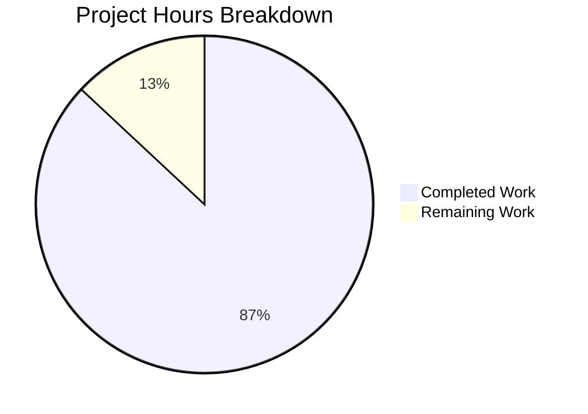
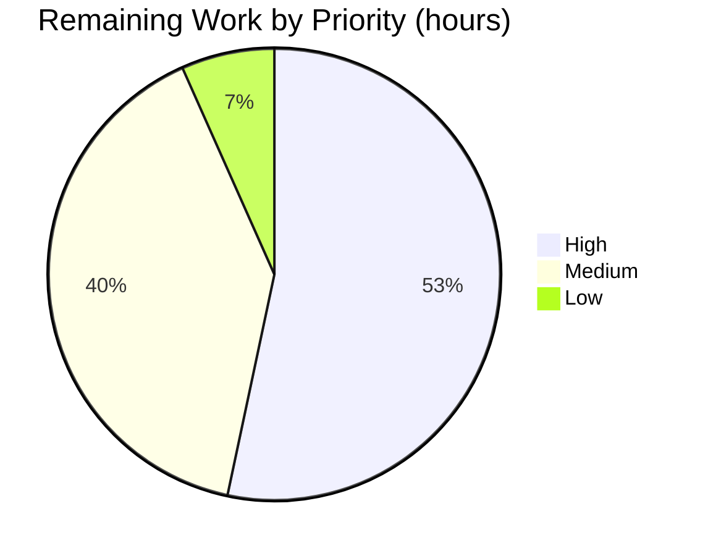

# 1. Executive Summary

## 1.1 Project Overview

`docs/gcp-to-aws-migration-test-plan.md` is one high-level test plan for moving an existing website from Google Cloud to AWS without re-architecting it. It tells a migration programme what to test, in what order, and what must be true before each traffic step proceeds: seven gated phases, nine comparable test areas, a weighted-DNS cutover with a rehearsed rollback, measurable gates, roles, environments, risks and traceability. Its readers are the programme's test lead, platform, data, security, performance and observability engineers, and the cutover manager. Nothing advances on opinion — every threshold is a number, a baseline comparison, or a value the programme must supply.

## 1.2 Completion Status



| Metric | Hours |
|---|---|
| Total Hours | 115 |
| Completed Hours (AI + Manual) | 100 |
| Remaining Hours | 15 |

**87% complete** — 100 completed hours of 115 total (100 ÷ 115 × 100 = 86.96%). Keys: 🟦 Completed `#5B39F3`; ⬜ Remaining `#FFFFFF`.

## 1.3 Key Accomplishments

- ✅ Eight sections in the scoped order, strategy through assumptions.
- ✅ Seven phases (P1–P7) with 23 entry and 42 exit criteria and scoped owners.
- ✅ Nine areas TA-1…TA-9, the same five fields each, a quantified threshold each.
- ✅ The GCP→AWS mapping in eight rows, all covered, both flagged rows conditional.
- ✅ Weighted DNS at 1%, 10%, 50%, 100% — smoked and monitored per step, rollback rehearsed twice.
- ✅ Eleven go/no-go entries, eight triggers, eight failure states, six edge cases.
- ✅ Eleven roles, three environments, nine dependencies, fifteen risks, traceability closed both ways.
- ✅ Twenty-nine placeholders and sixteen assumptions visible, none invented.

## 1.4 Critical Unresolved Issues

Four open items against the thirty-eight scoped requirements — two on one length matter, one wording, one programme precondition.

| Issue | Impact | Owner | ETA |
|---|---|---|---|
| Document length runs past the page guide the plan is scoped against (2 requirements, both at 0.90) | A reader expecting a ten-page brief reads roughly half again as much; the "one sitting" property is the one at risk. No content is missing | Test Lead | 6h |
| Rollback error-rate wording abbreviated to "across two windows" against the scoped "two consecutive monitoring windows" (1 item) | Cosmetic; both sites agree and mean the same sustained-breach condition | Test Lead | 1h |
| 29 placeholder values and 16 assumptions awaiting programme confirmation (1 precondition, not a delivery gap) | No test area, gate entry or trigger that depends on an unset value can be reported as passed, so the plan cannot be executed as delivered | Programme / Test Lead | 8h |

## 1.5 Access Issues

No access issues identified — this deliverable needs no credential, service or network path.

| System/Resource | Type of Access | Issue Description | Resolution Status | Owner |
|---|---|---|---|---|
| None | — | No access issue blocks building, validating or deploying this deliverable | Resolved — none outstanding | — |

Executing the plan needs nine external preconditions it records with owner roles (target account, network, DNS, certificates, third-party access, source read access, a load window, fault-injection approval, restore tooling) — those belong to the programme.

## 1.6 Recommended Next Steps

1. [High] Agree the twenty-nine values and sixteen assumptions and re-issue the plan (8h).
2. [Medium] Bring the document to its page guide, or record that the band does not bind it (6h).
3. [Low] Restore the full rollback error-rate wording at §3.10 and §5.2 (1h).
4. [Medium] Confirm the two flagged mapping rows; their applicability changes TA-3, TA-5 and TA-8.
5. [Low] Re-run the two published checks after every edit.

# 2. Project Hours Breakdown

## 2.1 Completed Work Detail

| Component | Hours | Description |
|---|---|---|
| Strategy and approach (§1) | 12 | Four test levels with the two deliberate non-levels; the assumed cutover model and its stage table; the test-data approach; the eight-row source-to-target mapping with both flagged rows and the like-for-like constraint; the three programme requirements; the conventions; six tool categories with their limits; the scope boundaries; the plan's own statement of how it is verified |
| Phase-by-phase activities (§2) | 10 | Seven phase blocks with the scoped owners, 23 entry and 42 exit criteria, and the single seven-row statement of which test types run in each phase |
| Test areas, states and edge cases (§3) | 22 | Nine five-field areas with quantified thresholds, including the equivalence assertions for compute idle-connection ordering, database settings and recovery windows, storage addressing and signing scope, CDN rebuild-and-retest with its cache differences, certificate region and validation-record retention, identity-policy semantics and the account-boundary grant, edge-rule staging and limit differences, analytics consent and tag firing, and session lifetime and role-based access; the five-row integration-points table; eight failure states with decisions and actions; six edge cases with treatments |
| Cutover, hypercare and gates (§4, §5) | 14 | The eight-check smoke set with its failure routing; the four weighted steps each with a monitoring window and TTL preparation; hypercare with its exit signals; the permitted-window rationale; eleven measurable go/no-go entries; eight measurable rollback triggers with the precedence rule; two rehearsed rollbacks covering post-shift writes |
| Roles, environments, dependencies and risks (§6) | 12 | Eleven roles with responsibilities and environments; three environments plus two control surfaces; nine external dependencies each with an owner role; the fifteen-row risk register with mitigations and test-area mappings |
| Traceability and mapping coverage (§7) | 6 | The nine-row traceability table and the eight-row coverage table, closed in both directions with no orphan |
| Assumptions and placeholders (§8) | 6 | The sixteen-row visible "Assumptions to confirm" list with a reason each and the twenty-nine-value placeholder inventory |
| Verification cycle | 12 | The structure and encoding checks run against every revision of the document, independent renders, the requirement-by-requirement comparison against the work's scope, and the join checks that re-derive every closure from the text |
| Integration and publication of the delivered revision | 6 | Bringing the eight sections, their inventories and the joins between them to one consistent revision, re-deriving each closure against the final text, and publishing the change on the project's branch |
| **Total** | **100** | Completed hours |

## 2.2 Remaining Work Detail

| Category | Hours | Priority |
|---|---|---|
| Align the document with the page guide it is scoped against — editorial compression keeping every mandated element, or a recorded decision that the band does not bind this deliverable (page-guide limb; §2.1's components stay whole) | 6 | Medium |
| Restore the full rollback error-rate wording ("two consecutive monitoring windows") at §3.10 and §5.2 together, so the failure-state table and the trigger list keep agreeing | 1 | Low |
| Confirm the twenty-nine placeholder values and sixteen assumptions with the programme, assign the owner any applicability gap falls to, and re-issue the plan with the agreed figures — path-to-production work, since no area, gate or trigger can be reported as passed until its value exists | 8 | High |
| **Total** | **15** | |

Completed 100h + remaining 15h = **115h total**; completion = 100 ÷ 115 × 100 = **87%**, matching Section 1.2 and Section 7.

# 3. Test Results

The project ships no unit, integration or end-to-end test suite, and no test runner, manifest or CI workflow: it is one Markdown document. Its verification is the pair of zero-install checks the project publishes, plus the structural, rendering and inventory checks below, all of which were run against the delivered revision (`docs/gcp-to-aws-migration-test-plan.md`, 439 lines, 46,865 bytes).

| Area / Category | Framework | Tests | Passed | Failed | Coverage | What This Proves |
|---|---|---|---|---|---|---|
| Markdown structure gate (the project's published check) | Python 3 standard library checker | 1 run over the deliverable, plus 1 run over a seeded broken fixture | 1 | 0 | n/a — no coverage instrumentation exists for a document | The document parses cleanly — no unbalanced fence, no heading-level jump, fourteen well-formed table blocks with uniform cell counts, newline-terminated — and the check discriminates: the seeded fixture is reported with two true findings and exits 1 |
| Encoding and file hygiene | `file` + byte census | 4 assertions (NUL, CRLF, UTF-8 validity, trailing newline) | 4 | 0 | n/a | The file is clean UTF-8 with no NUL bytes, no CRLF line endings and exactly one trailing newline, so it renders and diffs identically on any platform |
| Document rendering | markdown-it-py 4.2.0 (CommonMark + table) | 1 render, 8 element assertions | 8 | 0 | n/a | All fourteen tables, one H1, nine H2 and thirty-six H3 render as real HTML elements with no literal markup, no code block and no stray hyphen leaking into body text |
| Section order and heading outline | Source census | 1 assertion | 1 | 0 | n/a | The eight numbered sections render in the scoped order, preceded only by the one-line front matter and ending with "Assumptions to confirm" |
| Table shape and column uniformity | Source census | 14 table blocks | 14 | 0 | n/a | Every table carries the inventory it claims, at its scoped row count, with no ragged or truncated block |
| Placeholder closure, both directions | Source census | 29 distinct values | 29 | 0 | n/a | The 29 bracketed values used in the body are exactly the 29 listed in §8.2, each named once, with no value invented on the programme's behalf |
| Cross-reference resolution | Source scan | every `N.M`, `TA-n` and `Pn` token | all resolve | 0 | n/a | No dangling section, test-area or phase reference exists, so a reader can follow every pointer in the plan |
| Unfinished-work and construct sweep | Grep sweep | 8 marker patterns over the deliverable | 0 findings | 0 | n/a | No TODO, FIXME, TBD, stub or work-in-progress marker, and no commented-out content, exists in the document |

**Not Covered**

- **Executing the plan.** TA-1…TA-9 were never run, and none is runnable from this repository: no GCP or AWS environment, traffic step, database, object store, load generator or third party was contacted, and no environment was provisioned. A human must run the plan in the target environments.
- **The plan's own gates.** The eleven go/no-go entries, the eight rollback triggers, the eight failure states and the two rollback rehearsals are stated and checkable, but their behaviour as decisions is exercised only when the migration is actually performed.
- **The twenty-nine values.** Every threshold that depends on an unset value is placeheld, so no test area can be reported as passed until the programme agrees them.
- **Renderers without table support and blank-line-sensitive dialects.** A viewer without Markdown table support shows the fourteen tables as pipe-delimited text; the two flagged mapping rows carry the blank line that makes them list items in every dialect, but that portability is asserted from the source rather than observed in every reader.
- **Narrow-viewport rendering.** The widest four-column table is squeezed at telephone width rather than clipped; no responsive requirement applies to this deliverable, so this was noted and not treated as a test outcome.

# 4. Runtime Validation & UI Verification

Reported below is what was actually driven on this deliverable. Nothing is listed that was not observed.

- ✅ **Document gate** — the published structure check ran over the delivered revision and returned exit 0: `docs/gcp-to-aws-migration-test-plan.md: 439 lines | structure OK`, alongside `README.md: 2 lines | structure OK`.
- ✅ **Encoding check** — clean: 46,865 bytes, 0 NUL, 0 CRLF, valid UTF-8, terminated by a single newline.
- ✅ **Full-document render** — 1 H1, 9 H2, 36 H3, 14 tables, 11 unordered and 3 ordered lists, 0 code blocks, no literal markup in body text.
- ✅ **Section read end to end** — front matter, then sections 1 to 8 in order, ending with "Assumptions to confirm"; every section reached from the top of the document without a broken pointer.
- ✅ **Inventory closure** — the 29 bracketed values used in the body are exactly the 29 listed in §8.2; the eight mapping rows match the eight coverage rows name for name in order; the risk register and the traceability table close in both directions.
- ✅ **Cross-reference resolution** — every section, test-area and phase reference resolves to a defined target; the widest four-column table renders uniformly with no empty cell.
- ⚠ **Blank-line-sensitive Markdown dialects** — the two flagged mapping rows under §1.4 render as a bullet list with the blank line the source now carries; a dialect that refuses to start a list after a paragraph would merge them, so the source form is what protects the rendering.
- ⚠ **Narrow-width rendering** — the widest four-column table is squeezed rather than clipped at telephone width; both viewport widths were inspected and neither scrolls horizontally.
- ❌ **No application to exercise** — the deliverable has no service, port, endpoint, page, command line or user interface, so there is no start-up, authentication, user journey or screen to drive. This is by design, not an omission: nothing is provisioned and no cloud account is opened.
- ⚠ **The plan's own runtime was never exercised** — TA-1…TA-9 were not run, no traffic step was taken, no database or object store was compared, no load was generated and no third party was contacted. Everything the plan describes as a source or target environment remains as it was.

# 5. Compliance & Quality Review

## 5.1 Compliance Matrix

| # | Deliverable | Status | Progress | Basis of Verdict |
|---|---|---|---|---|
| 1 | Strategy and approach: test levels, cutover model, test-data approach, mapping, programme requirements, conventions, tool categories, scope boundaries, self-verification | ✅ Pass | 🟦 `#5B39F3` | All elements present at their scoped counts; services named only where the mapping needs them; the data rule prohibits live customer personal data in non-production |
| 2 | Seven phases in order, each with entry criteria, exit criteria, an owner role and the test types run in it | ✅ Pass | 🟦 `#5B39F3` | Seven blocks with the scoped owners, 23 entry and 42 exit criteria, and a single statement of test types per phase |
| 3 | Nine test types as test areas in one consistent five-field format with a quantified threshold each | ✅ Pass | 🟦 `#5B39F3` | Nine areas, each field present once in order; every threshold quantified or placeheld; the equivalence assertions for the mapping's behaviour differences carried in the areas they belong to |
| 4 | Source-to-target mapping table with every row covered by at least one test area | ✅ Pass | 🟦 `#5B39F3` | Eight rows in both tables, identical names and order, 8/8 covered, both flagged rows conditional with a gap-with-a-named-owner treatment |
| 5 | Cutover and hypercare testing with a smoke test and a monitoring window at each step | ✅ Pass | 🟦 `#5B39F3` | Eight-check smoke set bound to every step with its failure routing; four steps staged from zero; windows never shorter than the maximum rollback time |
| 6 | Measurable go/no-go checklist and rollback trigger list, with the rehearsed rollback and the maximum time | ✅ Pass | 🟦 `#5B39F3` | Eleven entries and eight triggers, all measurable; two consecutive rehearsals covering post-shift writes inside `[Max rollback time]` |
| 7 | Roles, environments, dependencies, risks and mitigations | ✅ Pass | 🟦 `#5B39F3` | Eleven roles with environments; three environments plus two control surfaces; nine dependencies with owners; fifteen risks each with a mitigation and a named area |
| 8 | Two-way traceability and mapping coverage with no orphan | ✅ Pass | 🟦 `#5B39F3` | Every area reaches a risk and every risk reaches an area; every mapping row reaches a test area |
| 9 | A visible "Assumptions to confirm" list and a placeholder for every unsupplied value | ✅ Pass | 🟦 `#5B39F3` | Sixteen assumption rows as the final section; twenty-nine placeholders listed and used, none replaced by an invented figure |
| 10 | Altitude: approach level, no scripts, code or per-test-case procedures — and roughly 5-10 pages | ⚠️ Partial | 🟦 `#5B39F3` 90% · ⬜ `#FFFFFF` 10% | Substance limbs fully met (0 code fences, no procedure, 22 numbered items total); the page limb is out of band at ~13-15 rendered pages |
| 11 | Platform neutrality, no invented specifics, documentation-only honesty, objective pass/fail | ✅ Pass | 🟦 `#5B39F3` | Services confined to the mapping and environment definitions; no date, person, team or mandated brand; no claim that producing the document ran a test or opened an account |
| 12 | One file delivered, no other path touched, no runtime, package or build configuration | ✅ Pass | 🟦 `#5B39F3` | One file added; the pre-existing README is byte-identical; no manifest, lock file, workflow, container or environment file exists |

## 5.2 AAP & Rule Divergences and Gaps

| # | What the AAP/Rule Required | What Was Delivered Instead | Why It Diverged | Impact | Remediation |
|---|---|---|---|---|---|
| 1 | A plan "roughly 5-10 pages" and readable in one sitting | 439 lines / 7,033 words, rendering to roughly 13-15 pages (`docs/gcp-to-aws-migration-test-plan.md`) | The scoping brief's own enumerated content — eight fixed sections, seven phases with criteria, nine five-field areas, fifteen risks, eleven gates, eight triggers, sixteen assumptions and twenty-nine placeholders — cannot fit the band, so keeping the mandated content whole was the decision taken; the plan asserts no length of its own | A stakeholder reading it as a ten-page brief reads about half again as much; the one-sitting property is what suffers, not coverage | Compression pass keeping every mandated element, or a recorded programme decision that the band does not bind this deliverable (6h) |
| 2 | The cutover flow shown as a flow diagram | A four-column stage table plus prose in §1.2 and step prose in §4.2 | The brief allows the flow "rendered **or described**", while the document-level constraints forbid code fences — and a fenced diagram is a code fence — so describing it was the option that satisfied both | None to content: the parallel run, the four weights, per-step windows, the breach branch and the hypercare exit are all carried in the table and its prose | None owed. A drawn diagram would require revisiting the no-fence constraint, which is a scoping change, not an edit |
| 3 | Each phase block carries the test types run in it | Each block carries a pointer — "types 2.8" — with the types stated once in §2.8's seven-row table | §2.8 is by the brief's own rule "the single statement of which test types run in which phase", so restating them per block would break that rule | A reader taking one phase block in isolation must turn to §2.8 | None owed; the requirement is met for every phase in that table |
| 4 | Rollback error-rate coverage expressed as "across two consecutive monitoring windows" | "across two windows" at §3.10's failure-state row and §5.2's first trigger | The shorter form was chosen during the length tightening and made identical at both sites, so the failure-state table and the trigger list cannot disagree | Cosmetic; both sites describe the same sustained-breach condition, so no decision changes | One edit to both sites together (1h) |
| 5 | The mapping table and its coverage each stated where the reader needs them | The mapping once at §1.4 and its coverage once at §7.2, with each flagged row conditional at §1.4 and carried as an assumption at §8.1 | The brief asks each fact to be carried, not repeated, and itself states the coverage once; single-statement placement keeps the two tables from drifting | None: both directions close mechanically with no orphan and no empty cell | None owed |

**Divergence 1 — length against the page guide.** The plan is scoped as a high-level brief of roughly five to ten pages; it renders to roughly thirteen to fifteen, measured at 439 lines and 7,033 words over fourteen tables. The cause is structural rather than careless: the scoping brief enumerates mandatory content — eight fixed sections, seven phase blocks with entry and exit criteria, nine five-field test areas, eleven gates, eight triggers, fifteen risks, sixteen assumptions and twenty-nine placeholders — and trimming to the band would mean deleting items the same brief requires. The trade-off is stated as the decision it was, and the plan asserts no length of its own. The reader must decide whether the band binds this deliverable; if it does, the work is an editorial compression pass over prose and the longest table cells, keeping every inventory, threshold and placeholder intact. Until then, treat the plan as a document read in several sittings.

**Divergence 2 — the cutover flow is described, not drawn.** §1.2 presents the cutover as a four-column, three-row stage table — parallel run at zero weight, the four weighted steps, hypercare — with a breach branch on every stage, and §4.2 carries the step mechanics as prose. The scoping brief permits the flow to be "rendered or described" while the document-level constraint forbids code fences, and a fenced diagram is a code fence, so describing it was the only option that satisfied both. Nothing is lost: the stages, the 1%/10%/50%/100% weights, the per-step smoke set, the monitoring windows, the reverse-the-weights branch and the hypercare exit are all readable from §1.2 and §4.2, and a reader needs the table in any case.

**Divergence 3 — the per-phase test types live in one table.** Each of P1 to P7 carries the line "types 2.8" instead of listing its own test types, because §2.8 is by the brief's own rule "the single statement of which test types run in which phase: no other table in this plan repeats that fact". The value is nevertheless held for every phase: §2.8's seven rows name all nine test types and cover all seven phases, and every referencing site points to it. The cost is a page turn for a reader who reads one phase block in isolation; the benefit is that the fact cannot drift between seven blocks. No action is owed — restoring a per-block list would create exactly the duplication the rule forbids.

**Divergence 4 — the rollback error-rate limb is abbreviated.** §3.10's met-trigger row and §5.2's first trigger both read "`[Rollback error rate]` across two windows", where the scoping brief says "across two consecutive monitoring windows". The shorter form was chosen during the length tightening and applied identically at both sites. Both agree, the surrounding text states that a met trigger is reversed rather than paused, and the neighbouring p95 limb carries its own explicit duration qualifier, so no reader can act on a looser condition than the plan intends. Closing it is a one-hour edit applied to both sites in a single change.

**Divergence 5 — mapping and coverage each appear once.** The eight-row mapping is written once at §1.4, its coverage once at §7.2, the per-phase test types once at §2.8, and the cutover mechanics once at §1.2 with §4.2 pointing back to them. The scoping brief asks each fact to be carried rather than repeated and states the coverage once itself, so the single-statement placement is the sanctioned form rather than a shortcut. The joins were re-derived from the delivered file: §1.4's eight rows and §7.2's eight rows match name for name in order, every row names a covering area, and both flagged rows remain conditional with their assumption entry at §8.1. No action is owed.

**Rule divergences: none.** The scoping brief records that no user-supplied rules were provided for this work and that there is no rule-versus-requirement conflict to resolve, so no rule was departed from anywhere in the deliverable and no departure comment is owed at any site. Every divergence above is a departure from the brief itself, and each is explained and closed or accepted on the terms stated in its row.

# 6. Risk Assessment

Risks below are forward-looking: what could still go wrong once the plan is used. Anything already resolved during delivery is not listed.

| Risk | Category | Severity | Probability | Mitigation | Status |
|---|---|---|---|---|---|
| No test area, gate entry or trigger that depends on an unset value can be reported as passed, so the plan cannot be executed as delivered until the programme agrees the twenty-nine values and sixteen assumptions | Technical | High | High | The plan's own §8.2 rule, §8.1's assumption list and the re-issue task in Section 2.2; work begins by agreeing the values first | Open — inherent to the no-invented-figures rule |
| The document has no automated gate: with no CI, linter or test suite, a later edit can silently break a table, a placeholder or a cross-reference | Technical | Low | Medium | Run the two published validation commands after every edit; the structure check catches malformed tables, unbalanced fences and heading jumps, and the placeholder census catches an inventory drift | Open — deliberately absent tooling |
| The whole plan rests on an undescribed stack: if the website turns out to have no edge firewall, TA-5 and TA-8 must test new configuration against its own behaviour rather than source parity, and TA-3's authentication assertions shrink to internal service-to-service calls | Security | Medium | Medium | §1.4's conditional note on both flagged rows, §8.1 row 2, and §7.2's gap-with-a-named-owner rule, which withholds a phase's exit criteria until the gap has an owner | Open — awaiting programme confirmation |
| No role is designated as the default owner of an applicability gap, although an unowned gap fails the phase | Security | Low | Medium | Assign the owner when the mapping rows are confirmed; the confirmation task in Section 2.2 includes it | Open |
| The document renders to roughly thirteen to fifteen pages against the five-to-ten-page guide it is scoped against, putting the "read in one sitting" property at risk | Operational | Low | High | The compression task in Section 2.2, or an explicit decision that the band does not bind this deliverable; the document claims no page figure | Open — a recorded trade-off |
| Nine external preconditions gate the plan's use and none is satisfied by the deliverable itself: target account rights, cross-cloud connectivity, DNS control with weights and TTLs, certificate issuance authority, third-party access, source read access, an approved load window, fault-injection approval and restore tooling | Operational | Medium | High | Each is recorded with its owner role, so the programme can schedule them before P1 and P4; nothing is provisioned by this deliverable | Open — programme-owned |
| Hypercare exit and source-decommission readiness both depend on measures that are still unset (`[Max P1 open age]`, `[Max P2 open age]`, `[Hypercare duration]`), so neither exit can be judged until they are agreed | Operational | Low | High | Covered by the value-agreement task in Section 2.2; the hypercare signals are stated and each is measurable once its figure exists | Open |
| Third-party integration depends on allow-lists, callback URLs and redirect URLs being re-registered against the new egress addresses, and on DNS/TLS mechanics at cutover (lowered TTL waited out, certificate readiness, the validation record left in place for renewal) — actions outside this deliverable | Integration | Medium | Medium | §5.1 entry 8 requires 100% of re-registrations confirmed in writing by the Third-Party Integration Owner, and TA-3's threshold requires zero residual allow-list entries and zero callbacks arriving at the source; TA-8 checks certificate and DNS behaviour at every step | Open — programme-owned during migration |

# 7. Visual Project Status




Colour key throughout: 🟦 Completed — Dark Blue `#5B39F3`; ⬜ Remaining — White `#FFFFFF`.

| Capability | State | Progress |
|---|---|---|
| Strategy and approach (§1) | Delivered | 🟦 `#5B39F3` 100% |
| Phase-by-phase activities (§2) | Delivered | 🟦 `#5B39F3` 100% |
| Test areas, states and edge cases (§3) | Delivered | 🟦 `#5B39F3` 100% |
| Cutover, hypercare and gates (§4, §5) | Delivered | 🟦 `#5B39F3` 100% |
| Roles, environments, dependencies and risks (§6) | Delivered | 🟦 `#5B39F3` 100% |
| Traceability and mapping coverage (§7) | Delivered | 🟦 `#5B39F3` 100% |
| Assumptions and placeholders (§8) | Delivered | 🟦 `#5B39F3` 100% |
| Altitude against the page guide | Open — editorial | 🟦 `#5B39F3` 90% · ⬜ `#FFFFFF` 10% |
| Rollback error-rate wording parity | Open — editorial | 🟦 `#5B39F3` 90% · ⬜ `#FFFFFF` 10% |
| Programme confirmation of the values the plan waits on | Open — precondition | ⬜ `#FFFFFF` not started |

Remaining hours total **15**, matching Section 1.2 and the Section 2.2 total.

# 8. Summary & Recommendations

This project delivered exactly what it was scoped to: one Markdown document, `docs/gcp-to-aws-migration-test-plan.md`, that tells a migration programme how to move a website from Google Cloud to AWS without re-architecting it. The plan carries the full scoped inventory — four test levels, seven gated phases with entry and exit criteria and named owners, nine test areas in one comparable five-field format with a quantified threshold each, the eight-row source-to-target mapping with its coverage, a progressive weighted-DNS cutover with an eight-check smoke set and a monitoring window at every step, eleven go/no-go entries, eight rollback triggers, eight failure states, six edge cases, eleven roles, three environments and two control surfaces, nine dependencies, fifteen risks, two-way traceability, sixteen assumptions and twenty-nine placeholders. The tree holds that file and the pre-existing two-line README, nothing else: no build, no dependency, no service, no configuration and no second document.

What was exercised to prove it works is the project's published pair of zero-install checks plus the structural and inventory checks a document of this shape needs. The structure check returns exit 0 on the delivered revision — 439 lines, no unbalanced fence, no heading jump, fourteen well-formed table blocks — and the encoding check is clean at 46,865 bytes with no NUL, no CRLF and a single trailing newline. An independent CommonMark render produces one H1, nine H2 and thirty-six H3 with all fourteen tables as real tables and no literal markup leaking into the prose. The inventories close in both directions: the twenty-nine bracketed values in the body are exactly the twenty-nine listed at §8.2, the eight mapping rows match the eight coverage rows name for name in order, and every risk reaches a test area and every test area a risk. Every cross-reference resolves. What was *not* exercised is equally plain: the plan itself has never been run — no environment was provisioned, no traffic step taken, no database or object store compared, no load generated and no third party contacted — and, because the values are placeheld rather than invented, no area, gate or trigger can be reported as passed until the programme supplies them.

Against the scope it was built to, the project is **87% complete**: 100 hours of completed work out of 115 total, with 15 hours remaining. Thirty-six of the thirty-eight scoped requirements are fully met; two fall short on the same settled matter — the document renders to roughly thirteen to fifteen pages against the five-to-ten-page guide it is scoped against — and one wording is abbreviated against the brief. The critical path to production is short and specific: agree the twenty-nine values and sixteen assumptions and re-issue the plan with the agreed figures (8h, and the only item that blocks the plan's execution); decide whether the page guide binds this deliverable and either compress editorially or record the decision (6h); and restore the full rollback error-rate wording at §3.10 and §5.2 in one edit (1h).

Success for the reader is measurable without a test suite. The plan is ready to hand to a migration team today: every gate entry, trigger and pass threshold is a number, a comparison against the captured source baseline or a value awaiting agreement, and nothing advances on verbal assurance. Treat it as a living document — every edit followed by the two published checks, and the assumption list kept current by the Test Lead, which is the role the plan assigns that duty to. The two flagged mapping rows should be confirmed first, since whether the website has an edge firewall and an end-user identity provider changes what TA-5, TA-8 and TA-3 must prove.

**Production readiness: ready with two minor editorials and one programme action.** The deliverable is complete as a plan of record and usable as it stands; it becomes fully ready for hand-over once the twenty-nine values are agreed and the two editorial items land. No structural, coverage or delivery gap stands in the way, no reference is dangling and no mandated element is missing — the only thing the plan cannot do on its own is decide the numbers the programme has not yet given it.

# 9. Development Guide

Everything below was run against the delivered revision in a checkout of this repository. The project is one Markdown document: there is nothing to compile, install, migrate or start, and the commands that follow are the whole of its build, test and verification story.

### System Prerequisites

- A POSIX shell (bash or equivalent).
- `python3` — any 3.x; only the standard library is used by the checks.
- `git` 2.x, to clone the repository and commit edits.
- `file` — the standard utility, used by the encoding check.
- A Markdown viewer with table support, to read the plan as intended (your editor's preview, or the repository's web view).

No compiler, runtime, package manager, container engine, database, message broker or cloud account is required, and no service, container or port is started at any point.

### Environment Setup

There is no environment to configure.

```bash
cd gcp-to-aws-migration-test-plan-repo   # the directory you cloned into
git status                               # a clean tree is the correct starting state
```

No environment variable, credential, certificate, service endpoint or configuration file is read by anything in this repository, so nothing has to be created, exported or sourced before working on it.

### Dependency Installation

There is nothing to install. The project declares no packages, so it has no manifest, lock file or install command — and none should be added: the deliverable is a single document, and adding a dependency manifest or a build configuration would contradict the boundary the plan itself records in its §1.8 and §6.3.

### Verification — the project's build and test equivalent

Run both checks after any edit to `docs/gcp-to-aws-migration-test-plan.md`. Exit status 0 means clean; exit status 1 prints the findings.

**1. Markdown structure check** — balanced code fences, no heading-level jump, a header and separator row in every table block, uniform pipes per row:

```bash
python3 - docs/gcp-to-aws-migration-test-plan.md README.md <<'PY'
import re,sys
def check(p):
    L=open(p,encoding='utf-8').read().splitlines();b=[];prev=0;blk=[];w=0;sep=False
    fence='`'*3
    f=sum(1 for l in L if l.lstrip().startswith(fence))
    if f%2: b.append(f'unbalanced code fences ({f} fence lines)')
    def close(k):
        if blk and (len(blk)<3 or not sep): b.append(f'line {k}: malformed table block ({len(blk)} row(s), separator={sep})')
    for i,l in enumerate(L,1):
        m=re.match(r'^(#{1,6})\s+\S',l)
        if m:
            n=len(m.group(1))
            if prev and n>prev+1: b.append(f'line {i}: heading jumps H{prev} -> H{n}')
            prev=n
        s=l.strip()
        if s.startswith('|') and s.endswith('|') and s.count('|')>=3:
            if not blk: blk=[i]; w=s.count('|')
            else:
                if s.count('|')!=w: b.append(f'line {i}: table row has {s.count("|")} pipes, header has {w}')
                blk.append(i)
            sep = sep or set(s)<=set('|-: ')
        else: close(blk[0] if blk else i); blk,sep=[],False
    close(blk[0] if blk else len(L))
    print(f'{p}: {len(L)} lines | {"structure OK" if not b else "STRUCTURE PROBLEMS"}'); [print('  -',x) for x in b]
    return 1 if b else 0
sys.exit(max([check(p) for p in sys.argv[1:]] or [2]))
PY
echo "exit: $?"
```

Expected output on a clean tree:

```
docs/gcp-to-aws-migration-test-plan.md: 439 lines | structure OK
README.md: 2 lines | structure OK
exit: 0
```

The check has teeth: run over a file seeded with a skipped heading level and a table missing its separator row, it reports both — `heading jumps H1 -> H4` and `malformed table block (2 row(s), separator=False)` — and exits 1.

**2. Encoding check** — no NUL bytes, no CRLF, valid UTF-8, exactly one trailing newline:

```bash
file docs/gcp-to-aws-migration-test-plan.md
python3 -c "r=open('docs/gcp-to-aws-migration-test-plan.md','rb').read(); print(len(r),'bytes,',r.count(b'\x00'),'NUL,',r.count(b'\r\n'),'CRLF, utf8:',r.decode('utf-8') is not None, ', ends with newline:',r.endswith(b'\n'))"
```

Expected output:

```
docs/gcp-to-aws-migration-test-plan.md: Unicode text, UTF-8 text, with very long lines (792)
46865 bytes, 0 NUL, 0 CRLF, utf8: True , ends with newline: True
```

**3. Inventory census** — run when an edit touches a threshold, a placeholder, a table or a cross-reference:

```bash
python3 -c "
import re;t=open('docs/gcp-to-aws-migration-test-plan.md',encoding='utf-8').read()
print('placeholders used:',len(set(re.findall(r'\[[A-Za-z][^\]\[]{0,60}\]',t))))
print('headings: h1',len(re.findall(r'^# ',t,re.M)),'h2',len(re.findall(r'^## ',t,re.M)),'h3',len(re.findall(r'^### ',t,re.M)))
print('code fences:',t.count('\`'*3))
"
```

Expected output:

```
placeholders used: 29
headings: h1 1 h2 9 h3 36
code fences: 0
```

**4. Unfinished-work sweep** — must stay empty, because the document carries no work-in-progress marker and no commented-out content:

```bash
grep -n -i -E "\b(todo|fixme|tbd|xxx|hack|stub|wip)\b" docs/gcp-to-aws-migration-test-plan.md || echo "no unfinished-work markers"
```

### Viewing and Reviewing the Document

There is no application to start and no port to open. Open `docs/gcp-to-aws-migration-test-plan.md` in any Markdown viewer with table support — your editor's preview, the repository's web view, or any CommonMark/GFM renderer — and you will see one H1, the nine section headings and all fourteen tables. A viewer without table support shows the tables as pipe-delimited source text, which is a limitation of that viewer and not of the document.

Reviewing the plan well means reading four things together: §1.2's cutover stage table with §4.1 and §4.2 (how traffic moves and what stops a step); §3.10's failure states with §5.2's triggers (which governs a breach — the met-trigger row reverses, the others pause); §5.1's eleven entries (what must be green before the first step); and §8.1 with §8.2 (what the plan assumes and which values are still unset).

### Example Usage

```bash
# read the gates and triggers without a viewer
sed -n '/^### 5.1/,/^### 5.3/p' docs/gcp-to-aws-migration-test-plan.md

# see the values the programme still has to supply
sed -n '/^### 8.2/,$p' docs/gcp-to-aws-migration-test-plan.md

# see the two flagged mapping rows and their conditional treatment
sed -n '/^### 1.4/,/^### 1.5/p' docs/gcp-to-aws-migration-test-plan.md

# commit an edit, then re-run the checks above
git add docs/gcp-to-aws-migration-test-plan.md
git commit -m "Clarify the replication-lag gate wording in the migration test plan"
git log --oneline -3
```

### Common Issues and Resolutions

| Symptom | Cause | Resolution |
|---|---|---|
| `unbalanced code fences (N fence lines)` | A fenced block was introduced — the document must contain no code fence at all, including a diagram fence | Remove the fence and present the content as a table or as prose |
| `line N: heading jumps H2 -> H4` | A heading was written with a level skipped | One H1 for the title, H2 for each numbered section, H3 for each X.Y subsection; never skip a level |
| `malformed table block (N row(s), separator=False)` | The separator row was dropped, or the table has no body rows | Restore the header row, the separator row and at least one body row |
| `table row has N pipes, header has M` | A cell was added or removed, or a stray pipe landed inside a cell | Make every row's pipe count match the header, or put the pipe inside inline code |
| `CRLF` or a missing final newline in the encoding output | The file was saved with Windows line endings, or its last line was truncated | Re-save as LF with a single trailing newline |
| A bullet list renders as prose with a literal hyphen in an older Markdown dialect | A list follows a paragraph with no blank line between them | Keep one blank line between the paragraph and the list — the flagged mapping rows under §1.4 depend on it |
| A table looks cramped | The four-column tables are wider than a telephone viewport | Read them at desktop width; the document sets no responsive requirement |

### Conventions to Keep When Editing

- One H1 for the title; H2 for each of the eight numbered sections; H3 for each X.Y subsection.
- Facts the plan declares single-statement stay single: the per-phase test types live only in §2.8, the mapping only in §1.4 with its coverage only in §7.2, the cutover mechanics only in §1.2.
- A value the programme has not supplied stays a bracketed placeholder such as `[Hypercare duration]`, is used in the body, and is listed in §8.2 — never replaced by an invented figure.
- Role names only: no team, person, date or tool brand is introduced.
- Every decision carries its reason, and every failure state carries a decision *and* an action.

# 10. Appendices

### A. Command Reference

All commands are run from the repository root. Every one was executed on the delivered revision.

| Purpose | Command |
|---|---|
| Confirm the working tree is clean | `git status --porcelain` |
| Show what changed against the first commit | `git diff --name-status fee497d..HEAD` |
| Check document structure (exit 0 = clean) | the structure-check script in Section 9, "Verification" step 1 |
| Check file encoding and line endings | `file docs/gcp-to-aws-migration-test-plan.md` plus the census command in Section 9 step 2 |
| Count placeholders, headings and code fences | the census command in Section 9 step 3 |
| Confirm no work-in-progress markers exist | `grep -n -i -E "\b(todo\|fixme\|tbd\|xxx\|hack\|stub\|wip)\b" docs/gcp-to-aws-migration-test-plan.md` |
| Read the gates and triggers | `sed -n '/^### 5.1/,/^### 5.3/p' docs/gcp-to-aws-migration-test-plan.md` |
| Read the values still to be supplied | `sed -n '/^### 8.2/,$p' docs/gcp-to-aws-migration-test-plan.md` |
| Read the flagged mapping rows | `sed -n '/^### 1.4/,/^### 1.5/p' docs/gcp-to-aws-migration-test-plan.md` |
| Read one test area in full | `sed -n '/^### 3.5/,/^### 3.6/p' docs/gcp-to-aws-migration-test-plan.md` |

There is no build command, no test command, no start command and no migration command for this project.

### B. Port Reference

None. This project binds no TCP port, starts no service, container, database, broker or cache, and configures no listener. Nothing to partition or avoid when several people work on it at once.

### C. Key File Locations

| Path | What it is |
|---|---|
| `docs/gcp-to-aws-migration-test-plan.md` | The deliverable — the whole migration test plan. Front matter plus sections 1 to 8; 439 lines, 46,865 bytes, fourteen tables, twenty-nine placeholders |
| `README.md` | Pre-existing two-line repository scaffold, unchanged by this work |
| `docs/gcp-to-aws-migration-test-plan.md` §1.2 | The cutover model: the stage table with the four weighted steps and the breach branch |
| `docs/gcp-to-aws-migration-test-plan.md` §3.1–§3.9 | The nine test areas, each with objective, method, example checks, pass threshold and owner |
| `docs/gcp-to-aws-migration-test-plan.md` §3.10–§3.11 | The states every area must handle and the six edge cases with their treatments |
| `docs/gcp-to-aws-migration-test-plan.md` §5.1–§5.3 | The eleven go/no-go entries, the eight rollback triggers and the two rehearsals |
| `docs/gcp-to-aws-migration-test-plan.md` §6.3 | The nine external dependencies, each with the role that owns it — the programme's precondition list |
| `docs/gcp-to-aws-migration-test-plan.md` §8.2 | The bracketed values awaiting programme agreement, each used in the body before it is listed here |

### D. Technology Versions

| Component | Version used / required |
|---|---|
| Document format | Markdown (CommonMark/GFM; the tables require a table-capable reader) |
| Python (for the verification commands) | 3.x — verified with 3.14.7; standard library only |
| `file` | 5.41 on the reference host |
| `git` | 2.56.0 on the reference host |
| Project runtime, packages and build tooling | None — the project declares no dependency, no version and no build step |

### E. Environment Variable Reference

None. No environment variable, secret, credential or configuration file is read by anything in this project, and none is needed to build, verify or review it.

### F. Developer Tools Guide

- **Editor / viewer.** Any editor with a Markdown preview renders the plan as intended; the preview must support tables. The repository's web view renders it too.
- **The two checks.** Section 9's structure check and encoding check are the whole automated safety net; run them after every edit and treat a non-zero exit as a blocker.
- **Inventory census.** Run Section 9's census command whenever an edit touches a threshold, a table, a placeholder or a cross-reference; the expected figures are 29 placeholders, 1 H1, 9 H2, 36 H3 and 0 code fences.
- **Linters.** No linter configuration ships with this project, and none is required: the structure check covers the failure modes that matter for this document (fences, heading jumps, malformed tables, ragged rows, line endings).
- **Diagram tooling.** Not needed: the plan carries no diagram source and no code fence. The cutover flow is a Markdown table, which every table-capable viewer renders.
- **Version control.** Work on the project's branch, commit the document alone, and keep the working tree clean — one file is the whole deliverable, so an accidental second file is visible immediately in `git status`.

### G. Glossary

| Term | Meaning in this plan |
|---|---|
| **TA-1 … TA-9** | The nine test areas: functional and regression; data integrity; integration; performance and load; security; resilience and failover; observability; DNS, TLS and CDN; rollback |
| **P1 … P7** | The seven migration phases, from pre-migration baseline to source decommission readiness |
| **Smoke set** | The eight short checks run at every traffic step before its monitoring window opens; a failure stops the step |
| **Go/no-go entry** | One of the eleven conditions that must be green before the first production traffic step |
| **Rollback trigger** | One of the eight measurable conditions that reverse the step or the cutover, taking precedence over the pause path |
| **Failure state** | A condition every test area must handle, each with a stated decision and an action |
| **Edge case** | One of six situations the plan treats explicitly, such as data written to both environments or scheduled jobs running twice |
| **Hypercare** | The period after the final traffic step in which the target is watched against exit signals and the source stays live and in sync |
| **Control surface** | A place a change is made — the DNS control plane and each provider console — recorded as such and never as a test environment |
| **Placeholder** | A bracketed value the programme has not supplied, such as `[Hypercare duration]`, listed in §8.2 and never replaced by an invented figure |
| **Like-for-like** | The constraint that the migration changes no architecture, feature, service pairing or cost design: where the target cannot reproduce a source behaviour, the difference is a recorded finding with a decision |
| **RTO / RPO** | Recovery time objective and recovery point objective — the measured bounds for failover and restore |
| **p95** | The 95th-percentile response time, compared against the captured source baseline |
| **Baseline-then-compare** | The convention that the source is measured first, and the target is judged against that capture |
| **Freeze** | The period in which the source stops taking production writes, with the reconciliation that closes it |
